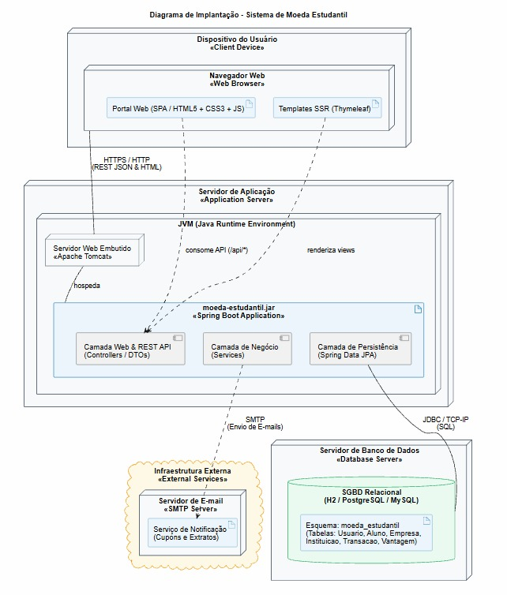

# Sistema de Moeda Estudantil

O **Sistema de Moeda Estudantil** reconhece o mérito estudantil por meio de uma moeda virtual. Professores distribuem moedas a alunos, que podem trocá-las por vantagens oferecidas por empresas parceiras.

O sistema foi desenvolvido na disciplina Projeto de Software do curso de Engenharia de Software da PUC Minas. Consulte os [requisitos](./docs/requisitos.md) e a [documentação](./docs/README.md) para conhecer o escopo e a modelagem.

## Acesse o sistema

**[Entrar no Sistema de Moeda Estudantil](https://moeda-estudantil-svme.onrender.com/index.html)**

## Conheça os recursos

| Recurso | O que o sistema oferece |
| --- | --- |
| Cadastros | Cadastro e gerenciamento de alunos e empresas parceiras. |
| Instituições | Listagem das instituições de ensino para vincular ao cadastro de aluno. |
| Moedas | Envio de moedas por professores e consulta de saldo e extrato pelos alunos. |
| Vantagens | Consulta e resgate de vantagens oferecidas por empresas parceiras. |

## Perfis e permissões

| Perfil | Permissões |
| --- | --- |
| Aluno | Consulta saldo, extrato próprio e catálogo. Resgata vantagens com seu saldo. |
| Professor | Consulta a listagem de alunos e os próprios envios. Envia moedas a alunos. |
| Empresa parceira | Cadastra e consulta vantagens próprias e acompanha seus resgates. |
| Administrador | Gerencia cadastros de alunos e empresas e consulta o extrato geral. |

## Arquitetura e tecnologias

O front-end e a API Spring Boot estão hospedados no mesmo serviço Docker no **Render**. O banco de dados é **PostgreSQL**, hospedado no **Neon**.




```text
Navegador → Spring Boot no Render → PostgreSQL no Neon
            ├── Interface HTML, CSS e JavaScript
            ├── Páginas Spring MVC com Thymeleaf
            └── API REST em /api
```

| Camada | Tecnologias | Responsabilidade |
| --- | --- | --- |
| Interface | HTML, CSS, JavaScript e Thymeleaf | Portal web e formulários MVC. |
| Aplicação | Java 17, Spring Boot, Spring MVC e Maven | Regras de negócio, endpoints REST e build. |
| Persistência | Spring Data JPA, Hibernate, PostgreSQL e H2 | PostgreSQL no Neon para o deploy e H2 em arquivo para execução local. |
| Hospedagem | Docker e Render | Build e execução da aplicação web em um único serviço. |
| Modelagem | PlantUML | Diagramas de casos de uso, classes, componentes e modelo ER. |

## Estrutura do repositório

```text
.
├── README.md
├── Dockerfile                         # Build e execução no Render
├── .dockerignore                      # Arquivos incluídos no contexto de build
├── pom.xml                             # Dependências e configuração do Maven
├── docs/
│   ├── README.md                       # Índice da documentação
│   ├── requisitos.md
│   ├── premissas-de-modelagem.md
│   ├── rastreabilidade.md
│   ├── diagramas/
│   │   ├── casos-de-uso.pdf
│   │   ├── classes.pdf
│   │   ├── componentes.pdf
│   │   ├── diagramas-sprint-01.pdf
│   │   ├── modelo-er-sprint-02.pdf
│   │   └── diagrama-implantacao.jpeg
│   ├── sprint-01/                      # Histórias de usuário e diagramas UML
│   └── sprint-02/                      # Modelo ER e decisão de persistência
└── src/
    ├── main/
    │   ├── java/                       # Domínio, serviços, repositórios e controllers
    │   └── resources/
    │       ├── application.yml          # Configuração local com H2
    │       ├── application-render.yml   # Configuração do deploy com PostgreSQL
    │       ├── static/                  # Portal web e estilos
    │       └── templates/               # Páginas Thymeleaf
    └── test/                           # Testes de integração e suas configurações
```

## Instalação e configuração

### Execução local

Com Java 17 e Maven 3.9 ou superior instalados:

```bash
mvn spring-boot:run
```

A aplicação ficará disponível em `http://localhost:8080/index.html` e usará o banco H2 local em `data/`.

## Equipe

- Bárbara Marcella Inácio da Silva
- Lucas Gabriel de Oliveira Franco
- Maria Clara Neri Stankunas
- Yago Garzon Chaves
