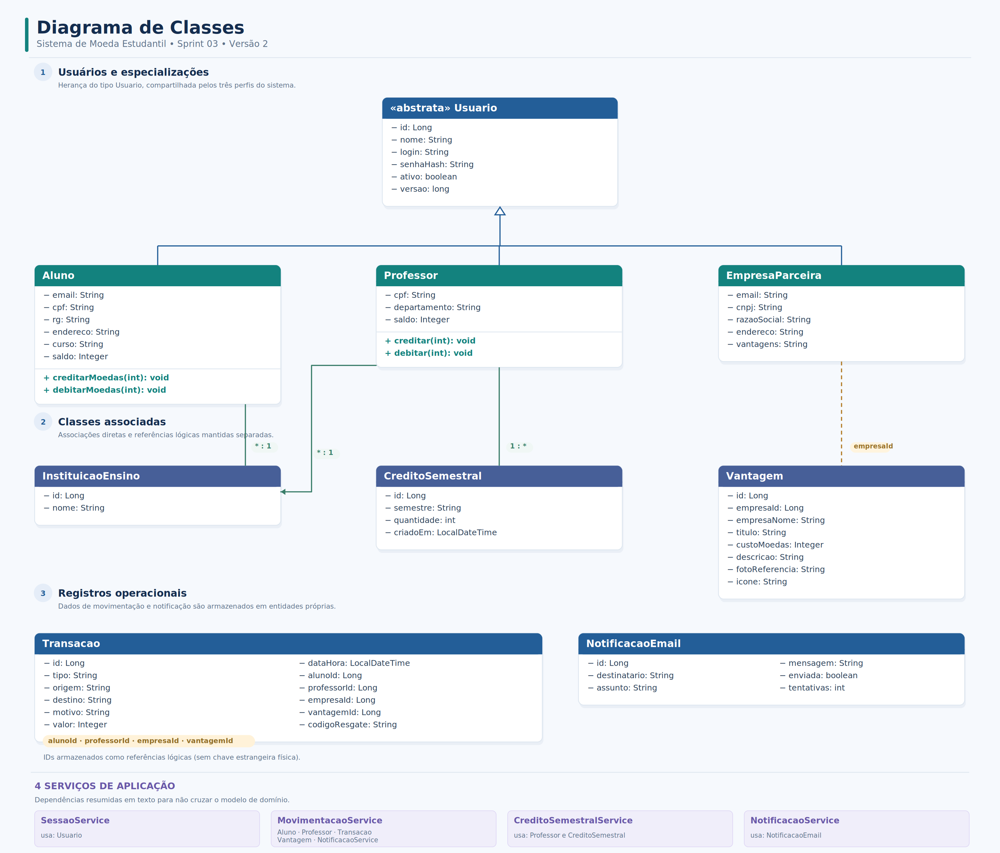
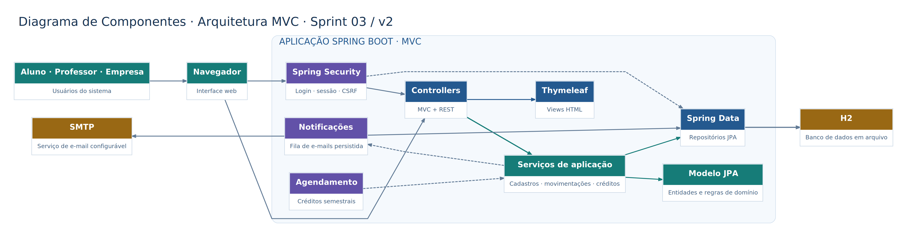
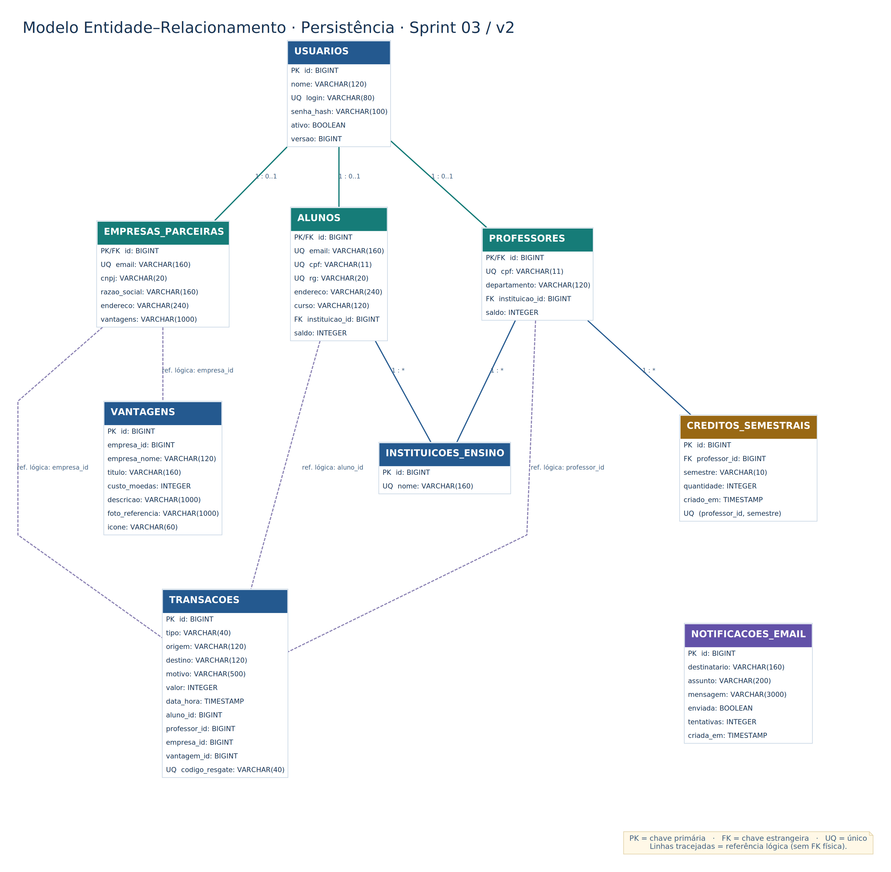

# Lab03S03 — Entrega final

## Escopo funcional

- Autenticação por login/senha e controle de acesso para aluno, professor e empresa parceira.
- CRUD de aluno e empresa parceira, com exclusão lógica e acesso restrito ao titular.
- Listas de alunos e empresas acessíveis apenas ao professor, com nome, dados básicos e situação de cada cadastro.
- Campo de CPF limitado a 11 algarismos na interface, com validação também no servidor; RG e endereço continuam obrigatórios conforme o enunciado.
- Persistência relacional H2 em arquivo, ORM JPA/Hibernate e repositórios Spring Data.
- Cadastro prévio de instituições; professores cadastrados no perfil de demonstração.
- Crédito de 1.000 moedas por semestre, acumulativo, com registro único por professor/semestre.
- Envio de moedas com motivo obrigatório e conferência do saldo do professor.
- Extrato individual por perfil, com movimentações vinculadas ao identificador do usuário.
- Cadastro de vantagens com custo, descrição e referência HTTPS da foto.
- Resgate de vantagens, desconto do saldo, código único de conferência e avisos ao aluno e à empresa.
- Fila de notificações persistida; envio SMTP executado quando a integração está configurada.

## Arquitetura

A aplicação segue MVC, com controllers Spring MVC e REST, serviços responsáveis pelas regras de negócio, entidades JPA e repositórios Spring Data. O banco é H2 em modo arquivo. O envio de e-mails utiliza registros persistidos, com tentativas agendadas; a falta de SMTP não cancela a transferência ou o resgate, e os registros permanecem pendentes.

Modelos da versão final:

- [Diagrama de classes — PNG](diagramas/v2/classes.png) · [SVG](diagramas/v2/classes.svg) · [PlantUML](diagramas/v2/classes.puml)
- [Diagrama de componentes — PNG](diagramas/v2/componentes.png) · [SVG](diagramas/v2/componentes.svg) · [PlantUML](diagramas/v2/componentes.puml)
- [Modelo ER — PNG](diagramas/v2/modelo-er.png) · [SVG](diagramas/v2/modelo-er.svg) · [PlantUML](diagramas/v2/modelo-er.puml)
- [Detalhamento da arquitetura e persistência](arquitetura-e-persistencia.md)
- [Rastreabilidade funcional](rastreabilidade.md)
- [Apresentação da Sprint 03 (PDF)](apresentacao-sprint-03.pdf)

### Diagramas em imagem







As versões da Sprint 01 e o Modelo ER da Sprint 02 permanecem em seus respectivos diretórios.

## Execução

Pré-requisitos: JDK 17 e Maven 3.9+.

```bash
mvn spring-boot:run
mvn test
```

Acesse `http://localhost:8080`. Os cadastros de alunos e empresas são feitos exclusivamente por professores autenticados. Visitantes podem apenas acessar a página de entrada. Professores são previamente cadastrados; para a demonstração, use:

```bash
mvn spring-boot:run -Dspring-boot.run.profiles=demo
```

Contas de demonstração (somente para ambiente local):

| Perfil | Login | Senha |
|---|---|---|
| Aluno | ana.silva | 12345678 |
| Professor | prof.carlos | 12345678 |
| Empresa | livraria.academica | 12345678 |

O perfil `demo` cria registros de exemplo apenas quando as tabelas correspondentes estão vazias. Utilize um banco H2 de demonstração e **não ative esse perfil em ambiente público**.

### Integração SMTP

Sem configuração SMTP, os avisos permanecem registrados na tabela `notificacoes_email` para envio posterior. Para habilitar a entrega, configure `EMAIL_ENABLED=true`, `EMAIL_FROM`, `SMTP_HOST`, `SMTP_PORT`, `SMTP_USER` e `SMTP_PASSWORD`. `SMTP_AUTH` e `SMTP_STARTTLS` controlam a autenticação e o STARTTLS. Não armazene credenciais no repositório.

### Restrições da versão

- O cadastro de professores e instituições ocorre fora da interface pública, como indicado no enunciado.
- O sistema não implementa recuperação de senha nem validação presencial do cupom; essas operações não foram detalhadas.
- O arquivo HTML de painel da Sprint 02 permanece preservado como artefato histórico. O fluxo operacional atual usa `/login` e `/painel`.
- O H2 em arquivo e a geração automática do esquema atendem à execução acadêmica, não ao uso em produção.
