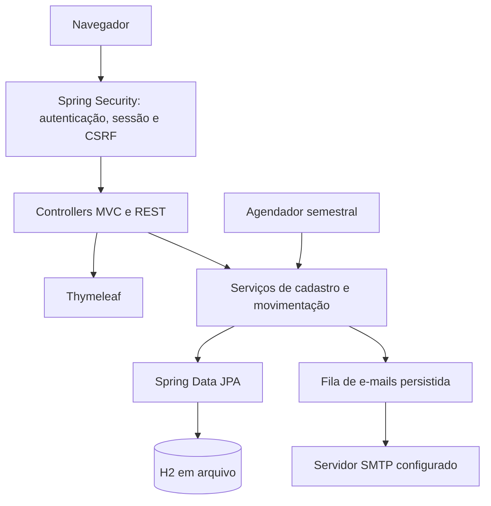
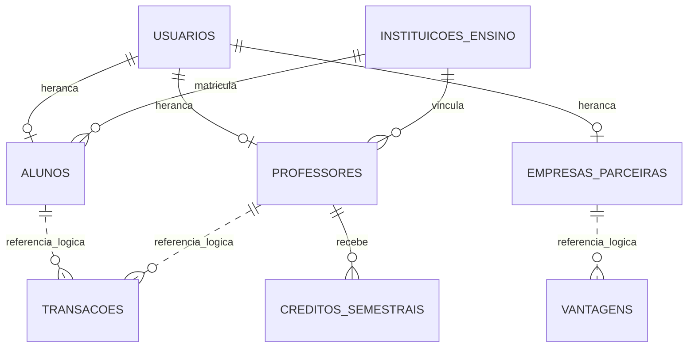

# Arquitetura e camada de persistência

## Organização MVC

A camada de apresentação utiliza páginas Thymeleaf e endpoints REST. Controllers tratam as requisições e delegam operações a serviços, que aplicam as regras monetárias, de cadastro e de acesso. Entidades JPA representam o estado persistente e os repositórios Spring Data encapsulam o armazenamento.

## Regras implementadas

**Transferência:** o professor autenticado seleciona o aluno e uma quantidade positiva; o motivo é obrigatório. O serviço verifica o saldo, debita o professor, credita o aluno e registra a transação na mesma operação transacional. O aviso é persistido na fila de e-mails.

**Resgate:** o aluno autenticado escolhe uma vantagem de empresa ativa. O custo é debitado do saldo, um código aleatório é associado ao resgate e duas mensagens contendo o mesmo código são registradas, uma para o aluno e outra para a empresa.

**Crédito semestral:** o serviço de agendamento registra uma carga de 1.000 moedas por professor ativo e semestre. A restrição de unicidade entre professor e semestre evita cargas duplicadas; o saldo anterior é preservado.

**Autorização:** a interface de cadastro inicial permanece pública. Consultas e alterações pessoais são restritas ao titular. O professor pode transferir moedas, o aluno pode resgatar vantagens e a empresa pode cadastrar vantagens.

## Persistência

- **SGBD:** H2 relacional, persistido em `./data/moeda-estudantil`.
- **ORM:** Hibernate por meio de Spring Data JPA.
- **Herança:** estratégia `JOINED` entre `Usuario`, `Aluno`, `Professor` e `EmpresaParceira`.
- **Concorrência:** campo `@Version` em `Usuario`, compartilhado pelas especializações.
- **Operações financeiras:** métodos `@Transactional` agrupam alterações de saldo, transações e mensagens pendentes.
- **Integridade:** restrições únicas em credenciais, documentos, códigos de resgate e crédito por semestre.
- **Exclusão de usuário:** lógica, por situação ativa/inativa; o histórico monetário não é apagado.

Os identificadores de usuário/empresa registrados em `Transacao` e `Vantagem` são referências lógicas, não chaves estrangeiras JPA. Essas referências preservam o histórico simples desta versão, enquanto os relacionamentos tipados de cadastro e de crédito semestral utilizam chaves estrangeiras.

## Tecnologias e camadas

| Tecnologia | Responsabilidade |
|---|---|
| Java 17 | Linguagem e plataforma |
| Spring Boot 3.5.7 | Configuração e execução |
| Spring MVC / Thymeleaf | Controllers e views |
| Spring Security / BCrypt | Autenticação, autorização e senhas |
| Spring Data JPA / Hibernate | Persistência e ORM |
| H2 | Banco relacional |
| Spring Mail | Transporte SMTP dos avisos |
| JUnit 5 / MockMvc | Testes de serviços e fluxos HTTP |
| Maven | Gerenciamento das dependências e build |
| PlantUML / Mermaid | Modelagem e visualização da arquitetura |
